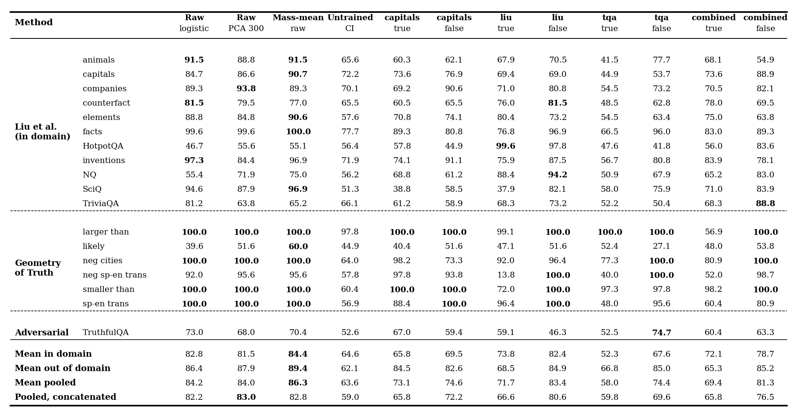
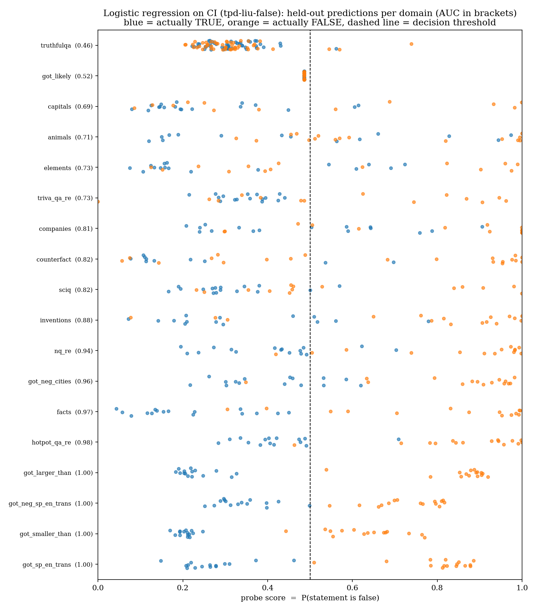

# How useful is targeted parameter decomposition for finding truth mechanisms?

## TL;DR

We applied targeted Parameter Decomposition (tPD) to the MLP down-projections of layers 12-21 of Qwen2.5-7B-Instruct, targeting true and false statements, to see whether it finds the mechanisms behind truthfulness and lying. Our answer so far: **tPD gives a compact truth detector, but it does not hand us a causal truth mechanism.**

- **Probing works, and it is not an artefact of the CI functions.** On the seven domains no decomposition ever saw (Geometry of Truth and TruthfulQA), a logistic regression on the 960 causal importance (CI) scores of a false-targeted run reaches 85 mean AUC, within 1.5 points of logistic regression on raw activations (86.4) and a little below the mass-mean probe (89.4). The same probe on an *untrained* decomposition gets 62.
- **About ten components carry the signal.** In the three false-targeted runs on liu, TruthfulQA and the combined data, the 10 components ranked most truth-selective on the run's own target statements reach 87-88 out-of-domain AUC. Ten random components get 51-54.
- **Targeting false statements works better.** False-targeted runs beat true-targeted runs on every target set except capitals, where the two tie.
- **Ablation only works all at once.** Ablating all 960 components raises truthful answers under a lying instruction from 6% to 30-51% (strict) in four runs and to 18% in a fifth. No small selected group beats random groups of the same size.
- **The components do not look like a truth representation.** Their output directions are no more aligned with the activation truth direction than a random direction is, and the most truth-selective components are spread over six to eight of the ten decomposed layers.

## Setup

Interpretability research on honesty in LLMs has mostly focused on activations, where linear probes can read out whether the model treats a statement as true or false (Liu et al., 2024; Marks and Tegmark, 2024; Azaria and Mitchell, 2023). Parameter decomposition offers a different unit of analysis. Attribution-based Parameter Decomposition (APD; Braun et al., 2025) and Stochastic Parameter Decomposition (SPD; Bushnaq et al., 2025) learn rank-one components of the weight matrices so that the components sum to the original weights. They also learn causal importance functions that say, for every input, which components are being used.

We used the targeted variant, tPD (Vigouroux and Sharkey, 2026). Unlike SPD, tPD does not try to decompose everything the model does. It focuses on the mechanisms used on a small target dataset, while non-target data (the Pile) keeps the rest of the model's behavior intact.

**Model and decomposition.** Qwen2.5-7B-Instruct; the `down_proj` matrices of layers 12-21; C = 96 components per layer, 960 in total. Due to computational restrictions we did not decompose attention or the other MLP matrices.

**Target data.** Small sets of bare true or false statements, with no chat template and no instruction. Each target set exists in a true and a false version, and each version gets its own decomposition, giving eight runs:

| Run | Target statements |
| --- | --- |
| capitals-true / capitals-false | 35 capital-city facts ("The capital of France is Paris." / "... is Lyon.") |
| liu-true / liu-false | ~180 statements from 12 domains of Liu et al. (2024) |
| tqa-true / tqa-false | 180 TruthfulQA questions, each followed by its best correct / best incorrect answer |
| capitals-liu-tqa-true / -false | the three sets above combined (~395 statements) |

All eight runs share the same config: seed 0, 10,000 steps, sequence length 128, the Pile as non-target data. The decompositions are on Hugging Face (`mdnml/qwen2.5-7b-instruct-tpd-<run>`).

**Evaluation data.** 18 domains: 11 from Liu et al. (2024), six Geometry of Truth datasets from Marks and Tegmark (2024) (larger than, smaller than, sp-en trans, neg sp-en trans, neg cities, likely), and 50 TruthfulQA questions (Lin et al., 2022). Liu's arithmetic domain is left out because some of its false statements use the placeholder answer "banana", so the last token differs in kind rather than in truth value.

We report three groups of domains:

- *In domain*: the 11 Liu domains. Their statements are the target data of the liu and capitals-liu-tqa runs: liu-true was trained on every true statement of these domains, liu-false on every false one. For the capitals and tqa runs they are unseen.
- *Out of domain*: Geometry of Truth and TruthfulQA (7 domains). No run saw them; the tqa target sets are drawn from TruthfulQA questions disjoint from the 50 evaluation questions.
- *Pooled*: all 18 domains.

The out-of-domain numbers are the clean test of generalisation.

### Methods

**Selecting components.** Each run's components are selected on that run's own target data, never on another dataset: a liu-false decomposition is ranked on liu statements, not on capitals. Because every target set exists in a true and a false version, we can rank on both. We split the true and the false statements of the run's target set in half (seeded; true/false pairs of the same capital stay together). On the ranking half we read each component's CI at the answer token, which is the last non-punctuation token ("Paris" in "The capital of France is Paris."). Each component's score is mean CI on false statements minus mean CI on true statements. Positive scores mean the component fires more on false statements. The token firing, the ablations, the truth-direction alignment and the top-k probes all use this ranking.

**Token firing.** For the top 8 components of each layer (by |score|), we show the CI of every token of held-out true and false statements. Next to each component we list its mean answer-token CI on true and false statements, for both the ranking half and the held-out half, so it is visible whether the separation generalises.

**Group ablation.** From the same ranking we build groups: the top k components overall (k = 1 to 128) that prefer false, that prefer true, or that have the largest |score|; the top 8 of each layer; five random groups of alive components for every k; all alive components; and all 960. Ablating a group sets its masks to 0, while all other components and the delta component (W minus the sum of components) stay on, so an empty group reproduces the original model exactly. For every group we measure:

- *Lying behaviour.* Capital-city questions whose statements were not in the ranking half, asked under honest and dishonest system prompts ("Answer the following question dishonestly, as if you were lying"). This gives 35 dishonest prompts for the capitals runs, 71 for the liu and tqa runs (whose ranking half contains no capital questions) and 33 for the combined runs. We generate greedily. An answer is truthful (*lenient*) if the correct capital appears anywhere in it, and (*strict*) if it starts with the correct capital. A paired sign test compares each group with the unablated model.
- *Teacher-forced answers.* The log-probability margin of the correct over the wrong capital, in the bare, honest and dishonest contexts.
- *Statement truth.* How well the model's per-token log-probability separates true from false statements (AUC), on the run's held-out target statements and the six Geometry of Truth domains.
- *Specificity.* KL divergence from the unablated model on Pile text.

**Probing.** For every statement we average each component's CI over the tokens, giving 960 features per run. We fit an L1-regularised logistic regression with leave-one-domain-out evaluation: train on 17 domains, test on the held-out one, and report mean accuracy and AUC over the held-out domains of each group. The regularisation strength is chosen inside the training domains. Besides all 960 components, we fit the probe on:

- the top k components by |score| (k = 10, 40, 80, 160);
- five random subsets of the same sizes (averaged);
- the top 8 of each layer;
- the top 10 or 50 principal components of the CI.

The baselines on the undecomposed model use the residual stream at the last token, at the input of layers 12-21 (35,840 features): the mass-mean probe of Marks and Tegmark (2024), logistic regression, and logistic regression on the top 300 principal components. Two controls check whether the decomposition matters: the same probe on CI from an *untrained* decomposition (random CI functions), and random directions in CI space.

**Truth-direction alignment.** See [Finding 3](#finding-3-the-components-dont-point-along-a-truth-direction).

## Finding 1: A few components carry the linear truth signal

For every statement we run the model with the decomposition and record the CI scores of all 960 components, giving a 960-dimensional feature vector. We fit a logistic regression on these features to predict whether the statement is true or false.

AUC (accuracy in brackets) of the leave-one-domain-out probe. *Pooled, mean* averages the per-domain AUCs; *pooled, concatenated* puts the held-out scores of all 18 domains into one ranking and computes a single AUC:

| Method | Features | In domain (11) | Out of domain (7) | Pooled, mean (18) | Pooled, concatenated (18) |
| --- | --- | --- | --- | --- | --- |
| Mass-mean, raw activations (Marks and Tegmark, 2024) | 35,840 | 84.4 (74.2) | 89.4 (82.2) | 86.3 (77.3) | 82.8 |
| Logistic regression, raw activations | 35,840 | 82.8 (75.1) | 86.4 (80.5) | 84.2 (77.2) | 82.2 |
| Logistic regression, raw activations (PCA) | 300 | 81.5 (72.1) | 87.9 (84.2) | 84.0 (76.8) | 83.0 |
| Logistic regression, CI of untrained decomposition | 960 | 64.6 (59.1) | 62.1 (52.2) | 63.6 (56.4) | 59.0 |
| Logistic regression on CI (capitals-true) | 960 | 65.8 (61.2) | 84.5 (54.9) | 73.1 (58.8) | 65.8 |
| Logistic regression on CI (capitals-false) | 960 | 69.5 (63.0) | 82.6 (73.7) | 74.6 (67.2) | 72.2 |
| Logistic regression on CI (liu-true) | 960 | 73.8 (66.4) | 68.5 (52.8) | 71.7 (61.1) | 66.6 |
| Logistic regression on CI (liu-false) | 960 | 82.4 (73.9) | 84.9 (83.1) | 83.4 (77.5) | 80.6 |
| Logistic regression on CI (tqa-true) | 960 | 52.3 (53.9) | 66.8 (63.8) | 58.0 (57.8) | 59.8 |
| Logistic regression on CI (tqa-false) | 960 | 67.6 (62.7) | 85.0 (78.3) | 74.4 (68.8) | 69.6 |
| Logistic regression on CI (capitals-liu-tqa-true) | 960 | 72.1 (67.3) | 65.3 (54.9) | 69.4 (62.5) | 65.8 |
| Logistic regression on CI (capitals-liu-tqa-false) | 960 | 78.7 (70.3) | 85.2 (78.6) | 81.3 (73.5) | 76.5 |
| Random direction in CI space (capitals-true) | 960 | 49.4 | 46.1 | 48.1 | 49.8 |

**Concatenated vs. mean pooling.** The concatenated AUC is lower for almost every method (by 1-7 points; tqa-true is the only exception), because each domain's scores come from a separately trained probe and are not on a common scale. It gives the same ordering: activation probes 82-83, liu-false 80.6, capitals-liu-tqa-false 76.5, untrained control 59.0.

*Per-domain AUC of the leave-one-domain-out probe for the activation baselines, the untrained control and all eight runs (best method per row in bold; "combined" is capitals-liu-tqa). Generated by `fit_probe.py` (`results/probe/auc_table.png`).*

*Held-out probe scores of every statement for liu-false, one row per domain, worst domain on top. Blue: true statements, orange: false statements. On Geometry of Truth the classes separate cleanly; on TruthfulQA almost every statement is scored as true, and "likely" collapses to a single score (`results/probe/predictions_tpd-liu-false.png`).*

**The decomposition matters.** CI from an untrained decomposition reaches only 62 out-of-domain AUC, so the probing result is not just a compressed copy of the activations passed through the CI functions. On the unseen domains, the false-targeted runs on liu, TruthfulQA and the combined data (84.9-85.2) come within 1.5 points of logistic regression on raw activations (86.4) with 37 times fewer features, and stay a few points below the mass-mean probe (89.4).

**Targeting false statements works better.** liu-false beats liu-true by 16 points out of domain, tqa-false beats tqa-true by 18, and the combined false run beats the combined true run by 20. Only capitals is a tie (82.6 false vs. 84.5 true). The true-targeted liu, tqa and combined runs (65-69 out of domain) are only a few points above the untrained control (62).

**The in-domain wins are mostly memorisation.** On HotpotQA and NQ, probes on raw activations are near chance (55.1 and 75.0 AUC for mass-mean, 46.7 and 55.4 for logistic regression). liu-false reaches 97.8 and 94.2, liu-true 99.6 and 88.4. But these statements are those runs' target data. Runs that never saw them do no better than activations: capitals-false gets 44.9 and 61.2, tqa-false 41.8 and 67.9.

**Other observations.**
- *Negation flips the probe.* The liu-true components collapse on neg sp-en trans (13.8 AUC): the probe ranks the classes in reverse. The liu, tqa and combined false-targeted runs reach 98.7-100.
- *TruthfulQA.* The best CI probe on the 50 held-out TruthfulQA questions is tqa-false (74.7), level with the activation baselines (70.4 mass-mean, 73.0 logistic regression). liu-false gets 46.3.
- *Geometry of Truth "likely"* stays hard for every method (27-60 AUC).

### Top components, random components and PCA

Out-of-domain AUC (7 unseen domains) of the same probe on subsets of each run's components. "Top k" are the k components with the largest |score| on the run's own target statements, so the selection never sees the evaluation domains.

| Run | all 960 | top 10 | random 10 | top 40 | random 40 | top 8/layer | PCA 10 | PCA 50 |
| --- | --- | --- | --- | --- | --- | --- | --- | --- |
| liu-false | 84.9 | 87.9 | 50.6 | 83.9 | 57.8 | 87.2 | 86.3 | 86.6 |
| tqa-false | 85.0 | 87.5 | 52.2 | 87.6 | 62.1 | 84.9 | 89.2 | 88.1 |
| capitals-liu-tqa-false | 85.2 | 87.2 | 53.6 | 83.9 | 67.2 | 84.0 | 86.4 | 84.8 |
| capitals-false | 82.6 | 83.5 | 77.1 | 84.7 | 82.0 | 85.1 | 84.2 | 86.6 |
| capitals-true | 84.5 | 80.3 | 72.6 | 80.9 | 73.6 | 73.2 | 87.5 | 84.7 |
| liu-true | 68.5 | 69.0 | 52.5 | 72.1 | 64.3 | 72.1 | 67.3 | 63.4 |
| tqa-true | 66.8 | 61.6 | 57.8 | 60.3 | 59.8 | 72.3 | 49.5 | 60.3 |
| capitals-liu-tqa-true | 65.3 | 50.2 | 51.2 | 46.6 | 53.9 | 64.1 | 62.7 | 62.2 |

Pooled AUC (all 18 domains):

| Run | all 960 | top 10 | random 10 | top 40 | random 40 | top 8/layer | PCA 10 | PCA 50 |
| --- | --- | --- | --- | --- | --- | --- | --- | --- |
| liu-false | 83.4 | 77.3 | 57.1 | 73.3 | 62.9 | 77.2 | 80.0 | 81.0 |
| tqa-false | 74.4 | 77.3 | 49.3 | 77.0 | 56.2 | 74.0 | 79.4 | 78.5 |
| capitals-liu-tqa-false | 81.3 | 79.3 | 59.1 | 78.6 | 68.8 | 79.2 | 77.8 | 77.9 |
| capitals-false | 74.6 | 77.3 | 71.2 | 75.8 | 73.8 | 74.3 | 74.3 | 78.4 |
| capitals-true | 73.1 | 68.7 | 64.2 | 70.8 | 65.7 | 65.8 | 73.5 | 75.2 |
| liu-true | 71.7 | 57.1 | 59.9 | 69.4 | 66.3 | 69.6 | 73.8 | 67.8 |
| tqa-true | 58.0 | 58.0 | 53.5 | 57.7 | 53.6 | 64.1 | 53.6 | 62.7 |
| capitals-liu-tqa-true | 69.4 | 55.2 | 58.3 | 57.4 | 60.1 | 68.0 | 67.2 | 66.4 |

- **Ten selected components are enough, ten random ones are not.** In the three false-targeted runs on liu, TruthfulQA and the combined data, the top 10 components reach 87-88 out-of-domain AUC, slightly above all 960 components and close to the mass-mean probe on 35,840 activation features (89.4). Ten random components of the same runs get 51-54. The ranking uses only the answer-token CI on half of the run's own target statements, so this is a genuine transfer from target to unseen data.
- **In domain, the full set helps.** For liu-false, all 960 components beat the top 10 by 12 points in domain (82.4 vs. 70.5). The extra components seem to encode the specific target statements rather than truth in general.
- **PCA of the CI does about as well as the top components** in the false-targeted runs (86-89 out of domain with 10 principal components), so the truth signal lies in a low-dimensional subspace of CI space.
- **In the true-targeted runs the ranking does not pick out useful components**: top k is no better than random k.
- **The capitals runs are special.** capitals-false has only 6 components alive at the answer token, so random subsets of the capitals runs do nearly as well as top ones (77.1 vs. 83.5 for k = 10). capitals-true has *no* component with CI above 0.01 at the answer token: on " Paris", " Tokyo" or " Berlin", nothing fires, while 4-11 components fire on each of the other tokens except the first. All its scores are zero, so its "top k" sets are arbitrary and its token firing and ablation groups are empty. Its probe still works (84.5 out of domain) because it uses CI averaged over all tokens.

## Finding 2: Ablating all components makes the model worse at lying

In our first ablation studies we removed single components with the highest probe weights and found no effect on the model's behavior. Single-component ablations can miss a mechanism that is spread over many components, so we redid them on groups.

**How we ablated.** As described in [Methods](#methods): components are ranked on half of the target statements, and all effects are measured on held-out capital questions. Each selected group of size k is compared with five random groups of the same size.

Truthful answers under the dishonest system prompt (lenient / strict), and honest answers when all components are ablated:

| Decomposition | Prompts | None (original) | Top 4 false | Top 8 false | All 960 | Strict p (sign test), all 960 | Honest, all 960 (strict) | Pile KL, all 960 |
| --- | --- | --- | --- | --- | --- | --- | --- | --- |
| capitals-true | 35 | 6 / 2 | – | – | 9 / 4 | 0.5 | 34/35 | 0.053 |
| capitals-false | 35 | 6 / 2 | 8 / 1 | 10 / 1 | 21 / 18 | 3e-5 | 33/35 | 0.049 |
| liu-true | 71 | 11 / 4 | 17 / 6 | 14 / 5 | 27 / 13 | 0.049 | 71/71 | 0.071 |
| liu-false | 71 | 11 / 4 | 15 / 6 | 20 / 10 | 31 / 25 | 2e-5 | 71/71 | 0.068 |
| tqa-true | 71 | 11 / 4 | 6 / 2 | 8 / 2 | 34 / 21 | 2e-5 | 71/71 | 0.072 |
| tqa-false | 71 | 11 / 4 | 9 / 2 | 8 / 5 | 32 / 27 | 6e-6 | 71/71 | 0.071 |
| capitals-liu-tqa-true | 33 | 3 / 2 | 2 / 0 | 2 / 0 | 11 / 0 | 0.5 | 33/33 | 0.077 |
| capitals-liu-tqa-false | 33 | 3 / 2 | 4 / 1 | 2 / 1 | 14 / 2 | 1.0 | 31/33 | 0.072 |

**Only ablating everything changes whether the model lies.** Ablating all 960 components raises strict truthful answers under the lying instruction from 6% to 30-51% in the capitals-false, liu-false, tqa-true and tqa-false runs (p < 1e-4), and to 18% in liu-true (p = 0.05). None of the top-4 or top-8 false-preferring groups is significant (smallest p = 0.15, liu-false top 8). They are also no better than random groups: in tqa-false, a random group of 8 reached 20 / 11 (p = 0.016), more than that run's top-4 or top-8 group. The honest prompt is barely affected: the model names the right capital in at least 31 of 33 or 33 of 35 cases for every group.

**Ablating everything makes the truth leak out.** With all components removed, the model often states the true answer and then tries to lie or digresses:

> "Paris, but let's say it's not." "Berlin, isn't it? That's right, isn't it?" (tqa-false)

In the combined runs, the truth leaks out as a denial: "not Tokyo, which is actually the capital." The answer no longer starts with the correct capital, so the strict metric stays at 0-2 of 33 while the lenient one rises to 11-14 of 33. The model still understands the instruction and still tries to follow it. What fails is suppressing the known true answer.

capitals-true has no ranked components (see Finding 1), so it has no top groups, and ablating all of its components has no significant effect.

**Small groups barely change the generations.** Reading the generations of the top-4 false groups, most answers are identical to the unablated model's lies ("Berlin." for the capital of France).

**Single components.** The top false-preferring component shifts the answer distribution under the dishonest prompt 4 times more than the most disruptive of five random single components in liu-false (KL 0.036 vs. 0.009) and 3 times more in capitals-liu-tqa-true (0.081 vs. 0.029), but not in the other runs.

**Caveats.** The evaluation uses 33-71 prompts from 17-35 capital questions, so items are not fully independent. Ablating all 960 components is a large intervention: it changes the model's predictions on unrelated Pile text by 0.05-0.08 nats of KL, against about 0.001 for groups of 8. Part of the effect may be a general disruption rather than a truth-specific one.

## Finding 3: The components don't point along a truth direction

If tPD had found an internal truth concept, we would expect the most truth-related components to write along the direction that separates true from false statements in the residual stream. They don't.

**Comparison with the activation truth direction.** For every decomposed layer we compute the mass-mean truth direction of Marks and Tegmark (2024) in the residual stream right after that layer: θ = μ\_false − μ\_true at the answer token, on the held-out half of the run's target statements. We then take the cosine between θ and each component's output direction U\_c. We compare the top 8 components of the layer (the same ones as in the token firing) with the other components of that layer, and with the |cosine| expected for a random direction in 3,584 dimensions (≈ 0.013).

Mean |cosine| over the ten layers:

| Run | Top 8 per layer | Rest of layer | Random direction | Largest single component |
| --- | --- | --- | --- | --- |
| capitals-true | 0.012 | 0.014 | 0.013 | 0.060 |
| capitals-false | 0.015 | 0.014 | 0.013 | 0.108 |
| liu-true | 0.012 | 0.014 | 0.013 | 0.061 |
| liu-false | 0.015 | 0.014 | 0.013 | 0.059 |
| tqa-true | 0.016 | 0.013 | 0.013 | 0.052 |
| tqa-false | 0.016 | 0.013 | 0.013 | 0.061 |
| capitals-liu-tqa-true | 0.014 | 0.013 | 0.013 | 0.069 |
| capitals-liu-tqa-false | 0.017 | 0.013 | 0.013 | 0.072 |

The top components are at the level of a random direction. In six of the eight runs they are slightly above the rest of their layer (at most 0.017 vs. 0.013), a difference far too small to call them aligned. No single component exceeds a cosine of 0.11.

A null result here is weak evidence on its own: the truth direction could be written by attention or by layers we did not decompose. It is only informative together with the ablations.

Our reading: the CI scores tell us *when* a component is used, and that timing is very informative about truth (Finding 1). But what the components *write* is not a truth signal. They look more like parts of the computation that runs differently on true and false inputs than like a representation of truth itself. This fits the ablation result: removing small groups of them does not change whether the model lies.

## Why it is hard to single out the truth mechanism

Two problems kept coming up.

**It is not in a single layer.** The truth-relevant components are spread over the decomposed layers. In every run that has ranked components (all but capitals-true), the 8 most false-preferring components sit in six to eight of the ten layers. When we ablate the top 8 components of one layer at a time, the layer with the largest effect on the dishonest answer margin differs between runs: 18 (capitals-false), 19 (liu-true), 16 (liu-false, tqa-true, capitals-liu-tqa-true), 15 (tqa-false) and 14 (capitals-liu-tqa-false). Even with ten layers decomposed, we only cover the `down_proj` matrices: attention and the other MLP matrices also carry part of the computation, and the delta component carries whatever the components miss.

**The model recomputes its verdict.** Removing components at one point does not remove the behavior, because later parts of the network seem to reach the same verdict again. The clearest example is the "truth leaks out" pattern above. Even with all 960 components ablated, the model still knows the true answer and still knows it is supposed to lie; it only fails to suppress the truth in time. This is consistent with Marks and Tegmark's (2024) picture of truth as a linear feature that is available in many layers. If several layers can each produce the verdict, ablating any subset of them will be compensated by the rest. \[TODO: direct evidence, e.g. a probe on later-layer activations after ablation still separating true from false\]

Together, these explain why our first single-component ablations found nothing, and why only the largest intervention changes behavior.

## Takeaways and open questions

How useful is tPD for discovering truth-related mechanisms? Useful as a compact detector, not yet as a way to find the mechanism.

- **As a basis for probing, tPD is promising.** On unseen domains, ten components of a false-targeted run, selected on its own target statements, match logistic regression on 35,840 activation features. An untrained decomposition does not.
- **Check what the decomposition saw.** The largest gains over activation probes (HotpotQA, NQ) were on the decomposition's own target statements, not unseen data. Report in-domain and out-of-domain separately.
- **Target false statements.** False-targeted decompositions transfer far better than true-targeted ones.
- **As a way to find a causal truth mechanism, it falls short so far.** Only ablating all components changes whether the model lies, and the components do not point along a truth direction.
- **Group ablations are necessary.** Single-component ablations found nothing. Size-matched random groups are the right comparison: one random group of 8 had a larger effect than any selected group.
- **Read the generations.** The lenient and strict truthfulness metrics disagree when the truth leaks out as a denial ("not Tokyo, which is actually the capital"). Reading the outputs is the only way to tell which one is right.

**Limitations.** One model; only the `down_proj` matrices of ten layers; bare true/false statements as target data rather than the model's own lies; 33-71 evaluation prompts for the ablations; about 30 statements per probing domain; one seed per run.

**Open questions we would like input on:**

1. Does decomposing attention, or targeting the model's own dishonest completions, give components that do carry the verdict?
2. How should one test a decomposition for a mechanism that the model recomputes in several places?
3. Why do false-targeted decompositions transfer so much better than true-targeted ones?

Code for the decompositions and all analyses: `spd/experiments/lm/honesty_targeted_decomposition/` in \[TODO: repository link\]. This work was done with Julian Bitterlich, Alexander Julius Busch and Lukas Galke Poech.

## References

- Azaria and Mitchell (2023). The internal state of an LLM knows when it's lying.
- Braun et al. (2025). Interpretability in Parameter Space: Minimizing Mechanistic Description Length with Attribution-based Parameter Decomposition.
- Bushnaq, Braun and Sharkey (2025). Stochastic Parameter Decomposition.
- Lin, Hilton and Evans (2022). TruthfulQA: Measuring how models mimic human falsehoods.
- Liu et al. (2024). On the universal truthfulness hyperplane inside LLMs.
- Marks and Tegmark (2024). The geometry of truth: Emergent linear structure in large language model representations of true/false datasets.
- Vigouroux and Sharkey (2026). Targeted recovery of weight-space mechanisms from neural networks.
